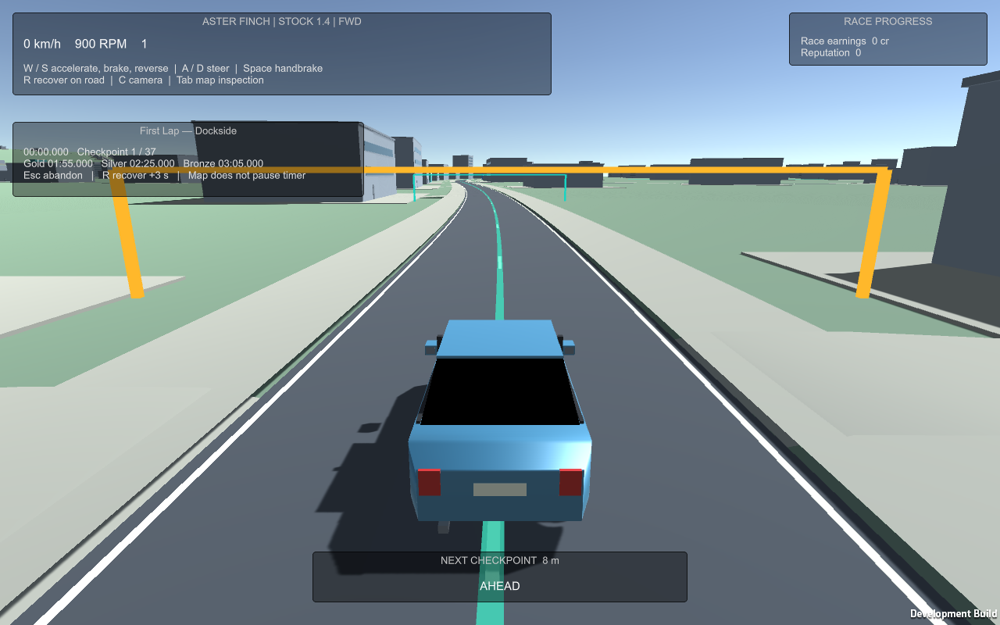

# Harbor Vale — First Lap

Open in **Unity 6000.6.0f1**, open `Assets/HarborValeGreybox/Scenes/HarborVale_CityMap.unity`, then press **Play**.

Local Windows build: **`Builds/HarborVale-FirstLap/HarborVale.exe`**. Build output stays outside Git; older driving previews are preserved.

Stop/slow at the nearby **FIRST LAP** arch and press **E**. Follow the teal route line through 37 ordered checkpoints around the 2 km Dockside loop. Earn credits, improve your medal/best time and replay. Race earnings and records save automatically.

| Control | Action |
|---|---|
| W/S or Up/Down | Accelerate, brake, reverse |
| A/D or Left/Right | Steer |
| Space | Handbrake |
| E | Start / retry trial |
| R | Recover (+3 seconds during race) |
| C | Chase / bonnet camera |
| Tab | Map inspection / return to driving |
| Esc | Abandon race / leave results |

Gold pays 700 credits; first completion adds 400 once. Replay payouts vary with medal. Race earnings are a prototype account; garage spending, car purchases and the complete career remain future work. The car, city and checkpoints use original placeholder geometry.

Rule/atomic save fixtures, actual Play Mode integration, driving regression and Windows export/smoke checks passed. Screenshots were inspected from a visible Windows player. Test gates were scripted; no manual full-lap or medal-pacing claim is made. See `artifacts/qa/M12-T01/visual-inspection.txt`.

Continue from `project/STATUS.md`, `project/NEXT_TASK.md`, `project/TASKS.json` and **`project/TRIAL_HANDOFF.md`**. Current map/driving sources and the independent handling test scene are preserved. Claude's separate art assignment is documented in `project/CLAUDE_ART_HANDOFF.md`; assets are not imported yet.
