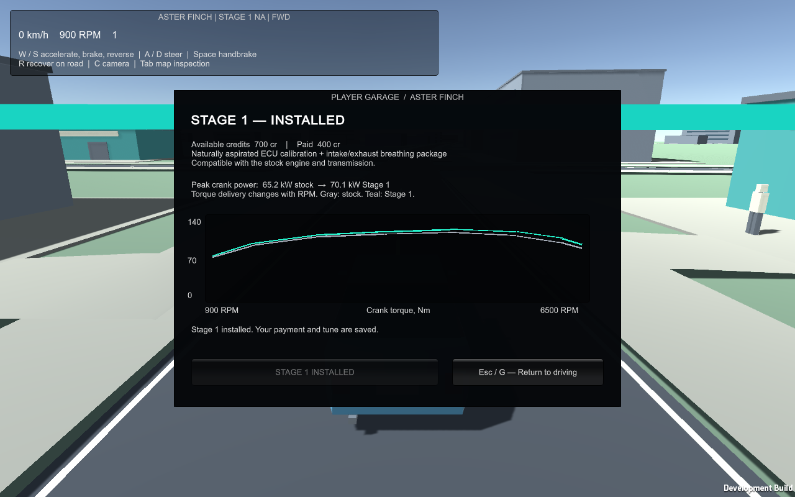

# Harbor Vale — race, earn, tune

Open the project in **Unity 6000.6.0f1**, open `Assets/HarborValeGreybox/Scenes/HarborVale_CityMap.unity`, then press **Play**.

Latest local Windows build: **`Builds/HarborVale-Garage/HarborVale.exe`**. Close older previews before switching. Executables stay outside Git.

1. Stop near FIRST LAP and press **E** to race the 2 km checkpoint loop.
2. Earn credits, then press **Esc** to return from results.
3. Stop near the player garage and press **G**.
4. Compare the torque curves and buy **Stage 1 for 400 credits** with Enter or the install button.
5. Drive the upgraded Finch. The payment and tune persist through restarting the game.

W/S accelerate/brake/reverse, A/D steer, Space handbrake, R recover, C camera, Tab map. Esc/G closes the garage. Racing recovery adds 3 seconds.

Stage 1 changes the authored RPM-dependent torque curve. Native measured 0–100 km/h improves from **13.56 to 12.84 seconds**. Peak crank power derives from the curve (~65.2→70.1 kW). Only the first naturally aspirated engine package is implemented so far.

Valid First Lap v1 progress imports into a separate v2 profile once. Old files remain unchanged; the current available-credit account is earned credits minus historical spending. Later old-build earnings do not synchronize automatically. Real player saves are never seeded by test probes.

Read `project/STATUS.md`, `project/NEXT_TASK.md`, `project/TASKS.json` and **`project/GARAGE_HANDOFF.md`** before continuing. Source, physics/rule/Play Mode/Windows restart evidence and actual UI snapshots are included. The complete ownership/maintenance career, later stages/conversions, AI opponents, traffic and police remain future work. Claude's workshop art stays separate until actual exports are verified.
