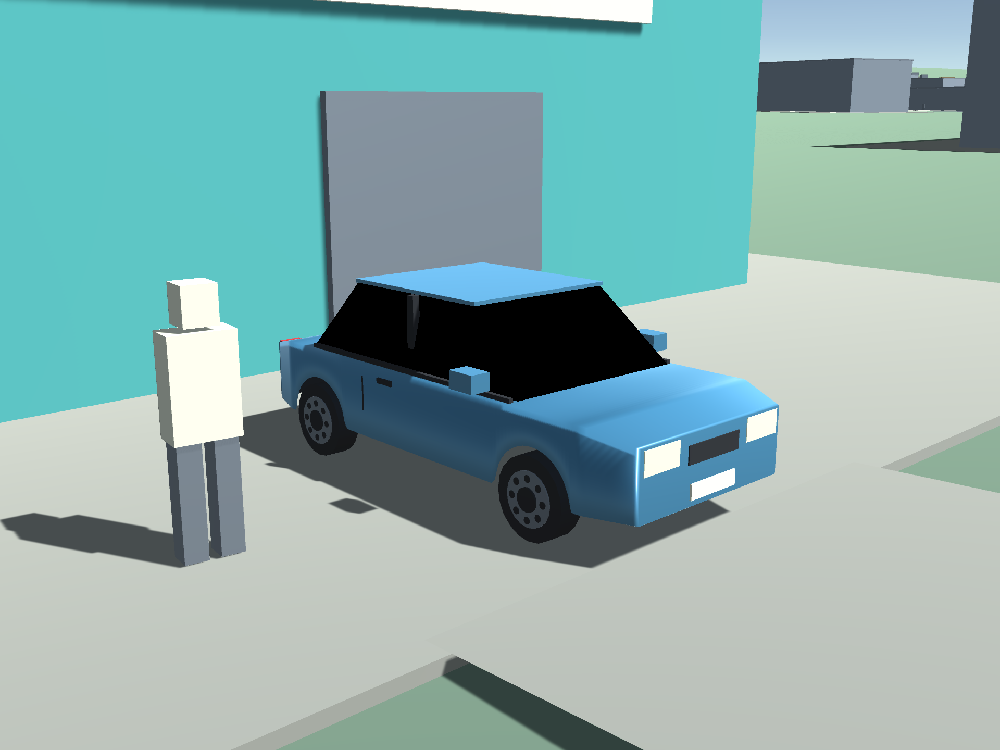
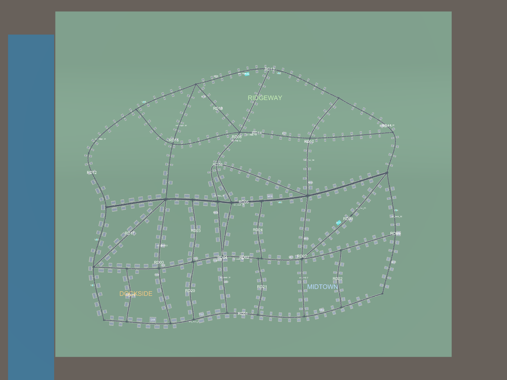

# Harbor Vale — scaled city prototype

Open this folder in Unity 6000.6.0f1, then open Assets/HarborValeGreybox/Scenes/HarborVale_CityMap.unity.

An expanded meter-scale city with 24 named curved roads, 39 junctions, about 29.5 km of roads, three districts and labeled services/events. Includes an original low-poly Aster Finch starter hatchback prefab outside the player garage. One unit is one meter; two-lane roads are 7.2 m wide; the Finch body is 4.05 m long.

Press Play to inspect: 1 city, 2 docks, 3 midtown, 4 ridge, **5 car**, **6 street**, F fly mode, RMB look, WASD move, Q/E height, Shift faster, L labels. The car is a static visual model; driving/racing and career systems remain future work.

Continuation: read project/STATUS.md, project/NEXT_TASK.md, project/TASKS.json and project/EXPANSION_HANDOFF.md. Full design documents and balance sources are included under docs/ and design-data/. Earlier Godot and map-prototype paths in design history are superseded by this Unity project and the expansion handoff.

All car and city geometry is originally authored procedural content with Unity primitives and built-in font/shaders. No third-party car model or licensed vehicle brand is included.
