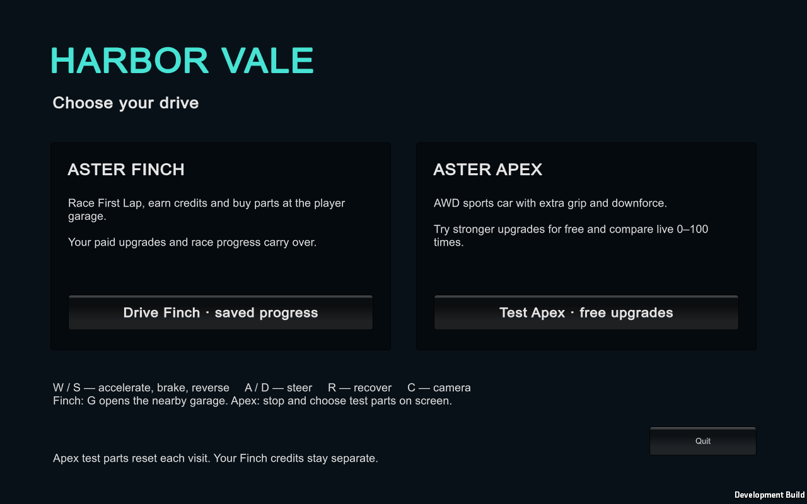
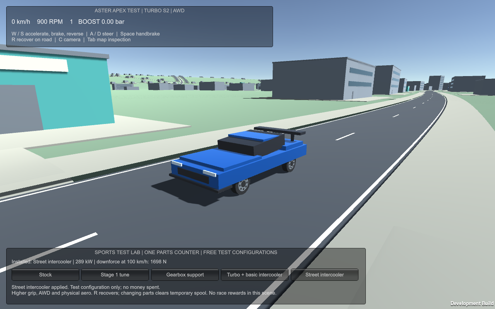

# HarborVale — choose a drive, race and test upgrades

Unity **6000.6.0f1**, built-in renderer. This is a playable prototype.

Latest Windows player: **Builds/HarborVale-Play/HarborVale.exe**. One menu selects saved Finch or free Apex. The bottom-right Main menu button returns between modes. In Unity open **Assets/HarborValeGreybox/Launch/Scenes/HarborVale_Hub.unity** and press Play.

In Apex mode, stop and apply free parts in order. Wait until **Arm test** is enabled, click it and accelerate to measure 0–100. Best times belong to each configuration for the current visit. Recovery or a changed build cancels the run. Road slope affects results. Sports settings reset when leaving; Finch paid progress stays saved.

## Sports test

Run **Builds/HarborVale-SportsTest/HarborVale-SportsTest.exe**, or open **Assets/HarborValeGreybox/SportsTest/Scenes/HarborVale_SportsTest.unity** in Unity and press Play.

Drive the blue Aster Apex: AWD, stronger brakes/grip, splitter/rear wing and physical speed-dependent downforce. Stop below 5 km/h and click the bottom buttons in order: Stock → Stage 1 → Gearbox → Turbo/basic intercooler → Street intercooler. Free test configurations reset on restart and never spend career money. Measured 0–100 improves from **6.10 to 4.44 seconds**. Model is original primitive placeholder geometry.

## Regular game prototype

Run **Builds/HarborVale-TurboParts/HarborVale.exe**, or open **Assets/HarborValeGreybox/Scenes/HarborVale_CityMap.unity**. Race First Lap with E to earn credits. Stop near the garage and press G. All parts are sold here: Stage1 400 credits → gearbox 250 → turbo/basic cooler 1900 → street cooler 400. Purchase in that order. Select with mouse or Up/Down; Enter installs. Payment/build survive restart. Valid older v2/v1 earnings/build import once to v3; use the latest build because old executables do not synchronize later earnings.

W/S accelerate/brake/reverse; A/D steer; Space handbrake; R recover; C camera; Tab map. Esc/G closes the regular garage. Racing recovery adds 3 seconds.

Read project/STATUS.md, NEXT_TASK.md, TASKS.json, BOOST_HANDOFF.md and SPORTS_TEST_HANDOFF.md. FEATURE_CHECKLIST.md separates completed work from future content. Native physics/rule/Play Mode and Windows checks are recorded; full-lap manual feel, controllers, optimization and the full ownership/maintenance career remain future work. Claude garage visuals are separate and not yet integrated. Local executables are not stored in Git.

Latest startup/timing handoff: project/LAUNCH_HANDOFF.md. Older standalone builds below remain preserved alternatives.
