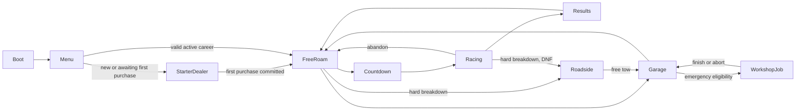

# Technical blueprint

## Status and engine choice

This is a proposed architecture. No engine project, vehicle controller or save implementation exists in the initial design package.

Use **Godot 4, standard build, GDScript**, targeting Windows x86-64. This is a practical starting choice for a project whose AI builders need readable scripts, scenes and data. It is an engineering recommendation, not an engine preference expressed by the user.

On 2026-11-17 the official Windows download page listed **Godot 4.7.2**. M00 must verify the executable, record its exact version and pin matching export templates. If an already established working environment requires a different stable patch, document the compatibility decision before scaffolding. [Official Windows downloads](https://godotengine.org/download/windows/).

Use the Compatibility renderer initially with restrained lighting and shaders. Treat visual and performance budgets as targets to measure on a recorded reference PC. Do not claim a minimum GPU or a frame rate before testing it.

## Vehicle implementation decision

Default: a **RigidBody3D chassis with four raycast suspension contacts and a shared arcade-friendly tire/drive force controller**. Both the player and race opponents use the same controller and derived car stats.

Godot documents limitations in its built-in VehicleBody3D and suggests custom physics integration for more demanding vehicle behavior. This supports prototyping the proposed custom controller; it does not establish that custom physics will automatically feel better. [VehicleBody3D reference](https://docs.godotengine.org/en/stable/classes/class_vehiclebody3d.html).

Keep the implementation small. Build and tune one controller before creating variants. If the prototype cannot meet the handling criteria, record a controlled alternative experiment with the built-in vehicle system or an evaluated dependency. Compare both on the same test course, preserve the working prototype and choose using evidence. Do not repeatedly rewrite physics while building the city.

Rigid bodies should normally move through forces. Godot provides `_integrate_forces()` for controlled interaction with physics state; repeated direct transform changes can cause problems. Ordinary driving uses forces, while resets use one explicit reset path. [RigidBody3D reference](https://docs.godotengine.org/en/stable/classes/class_rigidbody3d.html).

### Coordinate and unit conventions

- One world unit = one meter; masses in kg, forces in newtons, internal speed in m/s.
- Chassis local forward is **-Z** in our controller; up +Y; right +X. Imported mesh orientation is corrected under a visual child.
- The UI may display km/h or mph; the choice never changes physics values.
- Physics initially runs at 60 fixed ticks per second. Input is sampled into a command; camera smoothing uses render delta. Tune and profile before changing tick rate.
- Car bodies use simple convex colliders, never render-mesh triangle collision. Static roads use appropriate static collision with clean joins.

### Force model, built in layers

1. Raycast from four suspension mounts toward the road. Exclude the chassis itself. Accept drivable static surfaces, not arbitrary decoration.
2. For each contact, calculate bounded spring compression and damping along the suspension axis. Clamp invalid, negative or implausibly large support forces. Measure contact-point velocity, including chassis rotation.
3. On the contact plane, resolve local longitudinal and lateral motion. Apply drive/brake forces and a limited lateral force opposing slip. Bound the combined tire force by available grip and wheel support load so accelerating consumes some cornering capacity.
4. Divide drive force over grounded driven wheels; do not apply a complete car's drive force independently to every wheel. Use drivetrain data for front/rear distribution. An airborne wheel provides no road traction.
5. Add rolling resistance and speed-dependent aerodynamic drag. Calculate engine torque from the installed RPM curve and induction state, then convert it through actual gear ratios, final drive, efficiency and wheel radius into requested tire force. Automatic gears and a forgiving launch coupling preserve accessible controls without turning RPM into a cosmetic animation. See `10_POWERTRAIN_AND_TUNING.md`.
6. Reduce maximum steering angle at high speed; smooth keyboard steering. Handbrake reduces rear longitudinal braking stability and rear lateral grip for controlled rotation. Apply the documented optional stability help consistently.
7. Add anti-roll and mild stabilizing assistance only after the base suspension and grip are measured. Keep coefficients named and inspectable. Do not hide per-car exceptions inside controller code.

Apply continuous forces according to the engine's force semantics; do not multiply by delta twice. Use impulses only for instantaneous effects. Avoid a speed clamp that adds energy or arbitrary rotation every frame. Available power, gearing and drag determine achievable speed; the catalog's approximate stock speed is a calibration target.

Every upgrade attribute needs an explicit physical connection: the engine package changes its torque curve and response; mass changes chassis mass; grip changes available tire force; brake deceleration changes maximum braking force; chassis rating maps monotonically to documented steering/lateral-response and suspension tuning; shift duration changes the brief drive-force interruption during automatic shifts. Keep those mappings centralized. A transmission upgrade that changes only a HUD bar or engine sound is incomplete.

### Powertrain computation contract

The authoritative engine definition is `design-data/powertrains.json`, referenced by the car's `powertrain_id`. The selected path and highest installed stage choose the active configuration; its hardware is a complete compatible package. Stock is stage 0. No global `power × stage multiplier` exists.

Interpolate torque linearly between sorted RPM knots. Derive power with `kW = Nm × RPM / 9549.2966`. For the displayed peak, also check an interior maximum of the quadratic power function on a falling-torque segment; the peak may lie between knots. Reuse that calculation for PI, dealer figures and garage previews. Do not keep another editable peak-power value in the car definition.

For a turbo configuration, its steady net torque curve already includes the RPM-dependent boost threshold. Its off-boost curve and transient spool availability determine how quickly that steady output is reached after a load change. Do not apply another RPM boost multiplier or multiply net torque by a displayed boost-pressure figure. Positive-displacement supercharger curves already include their authored drive losses; no second parasitic deduction or turbo-lag state applies to them.

The engine computes a total crank torque request. Multiply by engaged gear and final drive, apply drivetrain efficiency once and divide by wheel radius to obtain total requested longitudinal road force. Distribute it over the driven contacts before enforcing each tire's combined grip budget. Never give every driven wheel the complete vehicle torque.

Use a small forgiving automatic launch coupling at low speed; prevent zero-RPM division and gear hunting. Shifts briefly reduce torque for the effective installed shift duration. A car's velocity, driven-wheel/RPM relationship, engine sound and shift indicator should agree. Resetting or switching cars clears transient RPM/gear/spool state to a safe launch state. Keep transient state on each vehicle rather than sharing it between cars; it is not persistent upgrade ownership.

### Prototype completion gate

On the test pad, demonstrate standing starts, 100-to-0 km/h braking, a constant-radius circle, an S-bend, a low curb, a ramp landing and a handbrake turn. Measure these on stock and upgraded configurations. Before the shop exists, inject named derived-stat test fixtures; repeat the comparisons through real purchases in M05.

Initial feel targets: starter reaches 0–100 km/h in roughly 10–13 s on level asphalt; a novice can recover from an ordinary slide; hitting a small road seam does not launch the car; a car resting on level ground does not continually jitter; keyboard input does not cause instantaneous full steering at highway speed. These are tuning targets, not results.

Preserve `game/scenes/tests/handling_test.tscn` throughout development. A handling change must be evaluated there before race difficulty is retuned.

## Proposed repository layout

```text
README.md, AGENTS.md
docs/                         design and build instructions
design-data/                  proposed source balance data
project/                      durable project memory and task ledger
prompts/                      entry prompts for builders
game/                         created in M00, not present initially
  project.godot
  scenes/
    boot/, world/, vehicles/, races/, garage/, ui/, tests/
  scripts/
    core/, vehicles/, races/, economy/, progression/, persistence/, ui/
  data/                       generated/imported validated runtime content
  assets/                     models, textures, audio, fonts and licenses
  tests/                      deterministic headless tests and fixtures
  tools/                      reproducible content/build helpers
artifacts/qa/<task-id>/        logs, screenshots and measurements
builds/windows/               generated exports, not source
```

Keep scripts and `.tscn`/`.tres` resources readable. Never embed secret keys or absolute developer-specific paths. Ignore generated `.godot/` caches and exported builds in source control; preserve required source assets and engine metadata.

## Responsibility boundaries

| System | Owns | Must not own |
|---|---|---|
| GameFlow | Boot/menu/free-roam/garage/race/results transitions | Price calculation or car physics |
| ContentDB | Validated definitions by stable ID | Player progress |
| VehicleController | Motion from derived stats and input commands | Cash or race rewards |
| Powertrain model | RPM/gear/spool state and torque request from installed configuration | Shop prices, reward settlement or direct chassis teleporting |
| PlayerInput / DriverAI | Same normalized driving command | Direct teleporting to win races |
| CarBuildService | Derive a car's effective stats and sell quote | Writing saves from UI callbacks |
| ConditionService | Driven-distance wear, persisted heat, warnings and bounded live condition effects | Changing the authored healthy torque curves or charging money |
| Vehicle history / used market | Persistent vehicle records, listing revisions, report visibility and transfer identity | Recreating a clean car after resale or inventing report data on every visit |
| RaceManager | Runtime participants, checkpoints, finish and valid result | Unvalidated wallet mutation |
| ProgressionService | Eligibility and best-result reputation deltas | Repeated rep for identical results |
| EconomyService | Purchase/install/sell and race-payout transactions | Scene-node persistence |
| SaveService | Validate, migrate, commit and recover state snapshots | Defining reward amounts |
| UI | Display state, submit requests, show outcomes | Independently changing balances |

Use a small set of autoload services for boot, content and persistence if useful; scene-local physics and race objects remain scene-owned. Avoid creating an autoload for every script. Dependencies should be explicit and mockable for tests.

## Data contracts

The economy document and `design-data/` own concrete IDs and numbers. The contracts below describe what runtime definitions must contain; adopt the existing reference-data field names during import rather than maintaining competing schemas.

- **CarDefinition:** stable model ID; display name; catalog MSRP (the existing `purchase_price` data field); reputation unlock; powertrain ID; stock mass, target speed, drivetrain, grip and braking values; compatible paths; visual scene reference. Peak power is derived from engine curves. Used listing prices are separate and do not change the MSRP basis for upgrade pricing.
- **PowertrainDefinition:** stock configuration; compatible paths; each stage's torque/induction configuration, individual reference payment, reputation gate, transmission prerequisite and included hardware; gear ratios, final drive, wheel radius and efficiency. Validate every stage and curve before use.
- **UpgradeDefinition:** stable category/stage ID; sequential-stage prerequisite; reference stage-total prices/effects for chassis categories or an engine-package reference; resale contribution. Recompute effective configurations from stock and the installed stage rather than mutating previous derived values.
- **EventDefinition:** stable event ID; district; mode; route ID; lap count where relevant; AI roster or time-trial thresholds; rep and prerequisite gates; recommended PI; payout and best-result rep data. V1 has no performance-score entry restriction, and all prerequisite-event lists are empty.
- **RouteDefinition:** stable route ID; ordered checkpoint transforms; directed gates; road/racing ribbon for AI, navigation and recovery; finish; AI racing line; safe reset transforms. Ordered gates determine legality; the ribbon does not create an invisible off-road disqualification rule. Different events can reuse a route with explicit start/direction differences.
- **LifetimeVehicleRecord:** stable physical vehicle ID; model ID; selected engine path or null at stock; installed stages; paint; odometer and residual distance; six condition values and residual wear accumulators; heat load; warnings/faults; history classification; append-only ownership/service/repair/upgrade records. The same record survives sale and reacquisition. Seed initial records once from `used_car_listings.json`; do not recreate them each time a menu opens.
- **OwnershipRecord / OwnedCar view:** stable ownership-instance ID pointing to a lifetime vehicle record; price paid in this ownership period; upgrade payments/investments made in this ownership period; acquisition receipt identifying preinstalled stages. UI can combine these into an OwnedCar view, but persist one authoritative copy of each vehicle's condition/build. One owned vehicle per model remains the limit.
- **UsedListing / InspectionReport:** persistent listing ID and revision; referenced vehicle ID; asking price and eligibility; free known-history/disclosure fields; paid inspection visibility and the revision inspected. Listing data is not a new vehicle. A purchase validates availability and revision, transfers that exact vehicle, removes the offer and records the acquisition atomically.
- **ServiceQuote:** vehicle ID, expected condition/save revision, requested component scope, exact total and resulting condition. A committed repair debits funds, updates only the scoped components and appends a receipt once. Historical service spending is distinct from upgrade investment and adds no separate resale credit.
- **PlayerProfile:** schema version; save revision; initial-purchase-complete flag; wallet; lifetime vehicle store; owned relations; active owned vehicle; used inventory/report state; workshop recovery state; event best results; first-clear flags; reputation; settled activity/result IDs; discovered lookout IDs; seen narrative IDs; safe free-roam location; tutorial flags; career completion.
- **Settings:** audio, display, key bindings, controller dead zones, speed units, camera and assistance settings. Keep settings in a separate file so a career reset preserves preferences.

No save format should serialize live scene nodes. Use IDs, primitive values and explicitly validated arrays/dictionaries. Derive net worth, performance score and unlocked lists when loading; avoid persisting contradictory cached totals.

Potential PI and the healthy-build comparison graph use the installed authored configuration. Show current mechanical condition/readiness and any live derating separately. Apply bounded condition modifiers after the healthy engine/induction calculation and before converting to wheel force; likewise apply declared tire/brake/suspension/shift effects through the correct interfaces. Never permanently multiply the source curve or conflate a repair with buying a higher performance stage.

Persist fractional distance/wear and heat so small increments are not rounded away every frame or reset by reloading. Count actual driven distance, not reset/fast-travel/tow jumps. Paused or offline time changes neither wear nor heat. History entries use stable IDs tied to their committed transaction; a retry cannot append a duplicate invoice. Distinguish a historical missing record from a verified current fault.

Store ownership acquisition odometer and a separate resettable trip baseline/residual. Unit changes convert display only, using exactly 1,609.344 meters per mile. Derive per-component last-service mileage from scoped work receipts, preserving null for unknown records. Derive separate assessment/check reminders from their own documented events and acquisition baseline; inspection is not service. Reminders never change condition, power, prices or race eligibility. Component replacement renews the component without rolling back the chassis odometer.

Use `design-data/release_scopes.json` to choose runtime content. Validate the full reference dataset for numeric integrity, but require actual scenes/routes only for the active release scope. The slice imports three models, four career events, four used offers, the workshop activity and stages 1–2; it does not show unavailable V1 stock or require its missing assets. M07 expands the same pipeline to V1. Seed each physical vehicle once. On a scope expansion, add only never-created vehicle/listing IDs; do not recreate a previously purchased or sold offer or replace its history. Keep future-definition validation distinct from runtime-asset validation.

## Game state and race lifecycle



Pause is an overlay preserving the underlying state and is available during driving and races at any speed. Countdown/cinematic camera locks and GUI focus cannot leak into free driving. Settings may open from pause. Race entry validates eligibility, current car and outstanding settlement state before spawning anything.

Each race creates a unique `race_run_id` and records its event/car at start. RaceManager produces a result from tracked checkpoint progress and finish order. EconomyService settles a valid result once. Reopening the results screen never awards a second payout.

On quitting during a race, no result is granted. Reload into a safe free-roam position, not halfway through a countdown. A finished race's payout and corresponding progression are committed together before the successful results state is acknowledged. If persistence fails, keep the pending settlement with the same ID, show a retry action and avoid granting a second reward.

Race ordering uses completed laps + checkpoint index + projected distance along the current route segment. Prevent progress from jumping to a nearby road on another level. Directional gate crossing advances only the next expected checkpoint; swept crossing handles a fast vehicle moving through the gate between physics samples.

AI competitors drive a path with lookahead steering, corner-speed targets and braking-distance estimates. They receive the same throttle/brake/steer interface as the player. Difficulty changes target pace, braking margins and small mistakes, not unbounded invisible extra speed. Stuck recovery restores the last valid safe point and accounts for its time cost using the same race reset penalty rule.

### Breakdown and emergency activity state

Use `maintenance.json` as the source for readiness, failure and heat thresholds. A worn car can be drivable in limp-home state while barred from career entry. A hard component failure stops positive drive demand and ends a live career attempt as DNF; subsequent coasting across the line cannot award a result. An already committed valid finish is never paid again or revoked by a later fault. A temporary heat-only protection cut keeps the race clock running and allows live engine-off cooling or abandonment. Persist its hysteresis latch until the release threshold is met, so reloading cannot clear protection early.

Tow is a free state transition to the workshop, not a component repair or a source of distance wear. Loading an owned broken car must return to a usable workshop/roadside recovery flow, not a repeatedly failing free-roam spawn. Heat-only shutdowns have a free engine-off live cooling path.

The emergency workshop activity borrows the verified time-trial route logic with an `activity_kind` distinct from `career_event`. A temporary healthy stock loaner is not an owned vehicle: it has no sale/upgrade action, does not alter the selected owned vehicle and is removed on return. Its fixed 300-credit completion pays once per unique activity run, grants no reputation/first-clear reward and cannot satisfy career prerequisites. Abandoning or reloading an unfinished job grants nothing and returns to the workshop with permanent state preserved.

Eligibility is computed from current owned-car readiness and minimum quotes: no owned car is roadworthy and the wallet is below the cheapest minimum-roadworthy quote. The maximum minimum quote is 1,200 credits, so four valid completions suffice from zero cash. If another owned car works, offer switching; if the minimum repair is affordable, offer repair; if only heat blocks readiness, offer free cooling. Do not invent a loan, negative balance or paid tow that defeats this recovery invariant.

## Economy transaction contract

All mutation requests follow one path:

```text
request -> validate against current snapshot -> compute full candidate snapshot
        -> validate invariants -> durable save -> publish committed state -> update UI
```

Use a transaction ID and save revision. Reject a stale or repeated purchase request. Reject invalid IDs, insufficient funds, duplicate ownership, locked inventory, incompatible or already-owned stages and selling the last car. UI disables a request while processing, but correctness cannot rely on the disabled button. Compute fixed percentage payouts and resale with integer numerators/division (for example 65/100), rather than relying on binary floating-point values just below an integer credit boundary.

Every performance purchase advances exactly one stage. Reject an attempted jump, a repeated paid stage, an incompatible engine path or a package missing its required transmission/mechanical readiness before debiting funds. An engine stage charges its own scaled/rounded paid-step price. Other categories charge rounded MSRP-based cumulative price of next stage minus rounded cumulative price of the currently installed stage, even when earlier hardware was acquired with a used car. Actual current-ownership investment is tracked separately for resale; subtracting that investment to quote a preinstalled build would overcharge the next step.

The engine path stays locked on the physical vehicle through resale and reacquisition. Tire/brake/suspension stage packages explicitly replace and restore only their own component to 10,000; their quote does not require repairing that old component first. Other components must satisfy the declared readiness requirements, and engine/transmission work requires a healthy core. Engine calibration, weight changes, preview, reset, tow and reload perform no free overhaul. A duplicated stage request cannot renew the component again. Paid service can replace wear items later while retaining their installed performance stage.

The quote states path commitment, required parts/condition, exact payment and component changes. Derive the candidate configuration for validation; persist ownership investment, path/stage, any authorized renewal, receipt and wallet together. Recompute derived output on load. Initial used hardware is recorded by an acquisition receipt, not a synthetic free stage-install transaction.

On sale, preserve the lifetime vehicle record and create the dealer buyback offer. The quoted buyback price is at least the last paid price and at least the current sale quote plus 500 credits. Reacquisition includes the installed build in its new paid-price basis and begins current-ownership upgrade investment at zero; earlier lifetime invoices remain visible. Condition/history valuation factors are bounded by one. Maintenance spending is never a second asset-value term. These rules prevent history washing and duplicate upgrade value.

Represent result settlement as a pure calculation plus a commit. Cash, first-clear flags, event best results, reputation and career unlocks all change in the same saved snapshot. Never debit money in one save and grant the car in a later save.

## Persistence and recovery

Godot's project content uses `res://`; writable user progress should use `user://`. These are engine paths, not Windows absolute locations. [Official data path guide](https://docs.godotengine.org/en/stable/tutorials/io/data_paths.html).

Proposed files: `user://career.json`, `career.tmp.json`, `career.backup.json`, and `settings.json`. Use a monotonic save revision and schema version. Do not promise universal atomic behavior from an untested sequence of file calls.

Commit procedure:

1. Build and validate a complete candidate state in memory.
2. Write a temporary file, flush/close it, then reopen and validate it.
3. Preserve the previous known-valid primary as the backup without replacing a good backup with corrupt content.
4. Replace the primary with the verified candidate using tested filesystem operations. Check error results. Keep recoverable valid candidates if an operation fails.
5. Acknowledge success and publish the in-memory state only after commit succeeds. A failed transaction leaves the prior committed state usable.

On startup, validate available candidates, select the highest valid committed revision according to the tested recovery rules, and disclose backup recovery. A verified temporary candidate can be recovered if the primary replacement was interrupted; document exactly how its completed revision marker distinguishes it from a partial write. Preserve invalid files for diagnostics rather than silently resetting a career.

Provide a developer fixture for future schema migration. A newer unsupported schema must remain untouched with a clear message. Validate money bounds, unique vehicle/ownership/listing/history IDs and references, active ownership, finite transforms, component/heat ranges, fractional wear, allowed build stages, report revisions, reputation consistency and content IDs. An explicit initial-purchase state permits zero cars and a null active-car ID, and loads into the guaranteed healthy starter dealer. After the first purchase completes, require at least one owned car and a valid active reference. That vehicle can legitimately be broken; preserve it and route to workshop recovery. Never send the initial zero-car profile into free roam or treat all-broken ownership as an unrecoverable corrupt save.

Safe positions must lie on supported drivable surfaces within world bounds. A bad position falls back to the garage spawn. Career completion remains saved and never removes vehicles. Autosave after inspections, purchases, sales, upgrades, repairs, faults and settlements, and after meaningful free-roam/tutorial progress. Checkpoint ongoing condition/mileage at sensible intervals and on orderly exits without writing every physics tick. Preserve already-applied wear/heat through pause and reload; a crash can lose only the uncommitted interval, not arbitrarily replace the car with a fresh one.

## World and content implementation

Build the first road network in meters using modular road pieces or an authored mesh with clean static collision. A visible road map and route graph share stable road/route IDs where practical. The full compact world may fit in one scene divided into three district subscenes; implement streaming only if measured memory or load time requires it.

Place race gates, AI line samples and reset anchors in editable route scenes. A validation tool checks order, nonzero segment length, surface support, safe spawns and referenced event IDs. Checkpoints should be wide enough for legal lines while preventing unintended jumps across junctions. Background barriers and marked closed roads manage the outer map boundary.

Garage/dealer interactions and fast travel require being stationary and outside active races; this restriction does not apply to pause. Car switching occurs only through valid garage transitions. Use world markers and a simple map before introducing a navigation pathfinder. Authored destination routes or a compact road graph are sufficient for V1.

## Build and verification commands

M00 writes `project/ENVIRONMENT.md` with the real engine executable, version, renderer, export-template version and reference PC. The following are **command templates, not commands executed during planning**. Run from the repository root after `game/project.godot` exists:

```powershell
$taskGodot = 'C:/actual/path/to/Godot_console.exe'
& $taskGod --version
& $taskGod --headless --editor --path ./game --import
& $taskGod --headless --path ./game --script res://tests/run_tests.gd
& $taskGod --path ./game
& $taskGod --headless --path ./game --export-release "Windows Desktop" ../builds/windows/Redline.exe
```

The test runner, export preset and output directory are created by implementation tasks before the corresponding commands are valid. Tests return a nonzero exit code on failure. The export preset name must match the actual preset. Review stderr as well as the process exit code. Headless import does not replace a visual driving check. Godot documents its command-line flags and export workflow in the [command-line guide](https://docs.godotengine.org/en/stable/tutorials/editor/command_line_tutorial.html).

## Technical risks and response

| Risk | Earliest useful experiment | Response if it fails |
|---|---|---|
| Cars feel unstable or lifeless | M01 handling pad | Tune suspension/grip/camera; compare a bounded controller alternative |
| AI cannot follow corners | First single sprint | Inspect racing line and speed planner before adding more opponents |
| Upgrades break economy or handling | First stat derivation tests | Recompute from stock and bound values; revise data |
| Interrupted writes lose purchases | Save fault-injection fixtures | Fix recovery and transactional commit before adding content |
| Large scenery hides poor performance | Greybox full-map traversal | Profile; reduce asset complexity before adding streaming |
| Context cutoff leaves conflicting code | Every task checkpoint | Preserve diffs; document unfinished substeps and rerun evidence |

The next implementer should work from the roadmap, not implement this entire document in one response.
